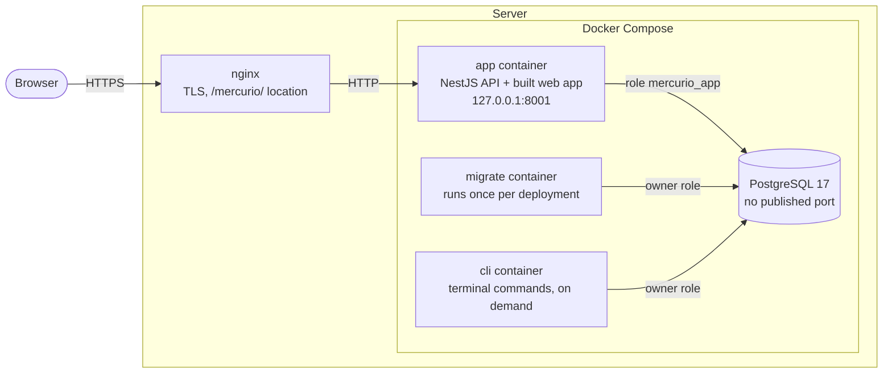
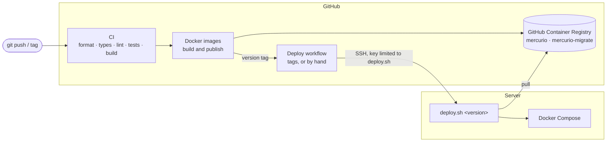
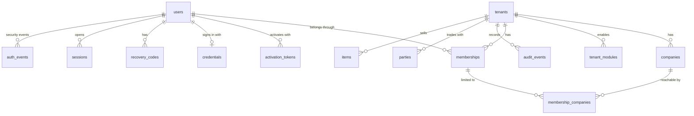
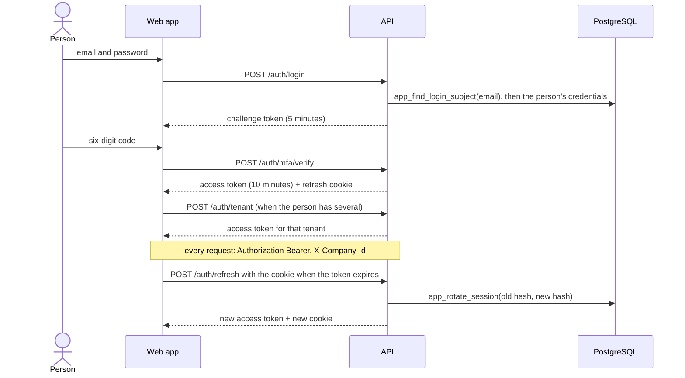
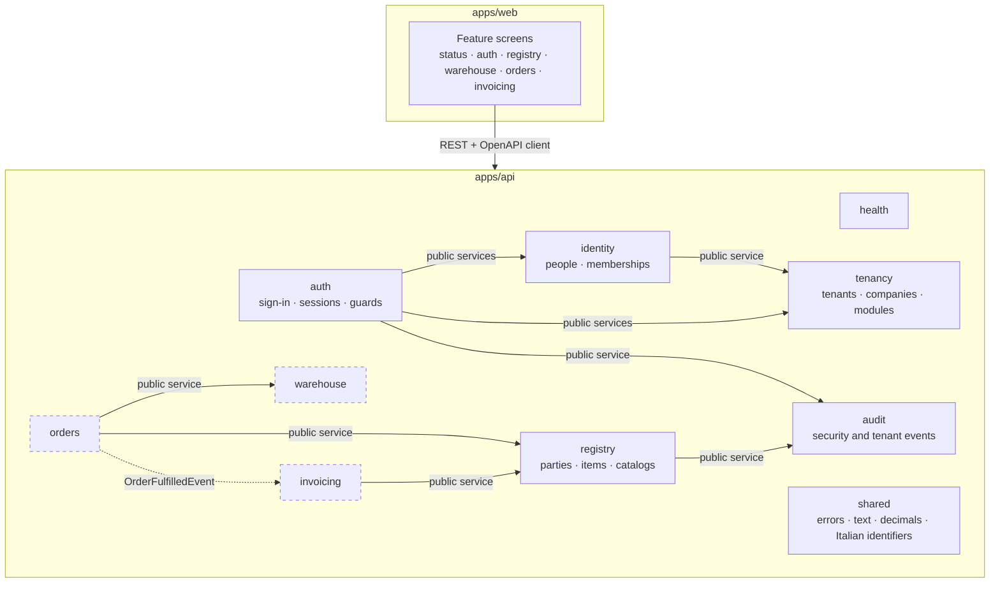

# Architecture

Mercurio is a modular monolith ([ADR 0001](adr/0001-modular-monolith.md)): one NestJS application
with one module per business area, a React single-page app served by the same process
([ADR 0004](adr/0004-api-serves-web-app.md)), and one PostgreSQL database.

This document describes what exists today and marks what is planned. Decisions behind each choice
are in [`adr/`](adr/); coding rules are in [conventions.md](conventions.md).

## Runtime



- **nginx** on the host terminates TLS and forwards `/mercurio/` to the container. It does not
  rewrite paths: the application knows its own prefix from `APP_BASE_PATH`.
- **app** serves the web app under `/mercurio/` and the API under `/mercurio/api/`. It listens only
  on `127.0.0.1`, runs as a non-root user with a read-only filesystem and no Linux capabilities.
- **migrate** applies pending Prisma migrations as the owner role, enables the login of the API's
  role (`mercurio_app`) and exits; the app starts only if it succeeds.
- **cli** runs terminal commands (create tenants and users, demo seed) as the owner role. Compose
  never starts it with `up`: it runs only with `docker compose run --rm cli <command>`.
- **app** connects as `mercurio_app`, which Row-Level Security applies to; it never receives the
  owner's credentials and refuses to start in production with a role that could bypass the policies.
- **db** is reachable only from the Compose network and stores its data in a named volume.

In development the same pieces run without nginx: PostgreSQL in Docker, the API with `nest start
--watch`, and Vite with a proxy for `/api`.

## Delivery



- Every push to `main` publishes images tagged `sha-<commit>` and `latest`; a tag `vX.Y.Z`
  publishes `X.Y.Z` and deploys it. Pull requests only build.
- The server builds nothing and has no copy of the repository: `deploy.sh` pulls the requested
  version, runs the migrations, restarts the app and waits until `/api/health` reports that version.
- GitHub's SSH key can only run `deploy.sh`. See
  [ADR 0007](adr/0007-continuous-delivery-github-actions.md).

## Tenants and data isolation

Several customers (tenants) share one database. Each tenant has companies, enabled modules and
members; one person can belong to several tenants
([ADR 0008](adr/0008-multi-tenancy-row-level-security.md),
[0009](adr/0009-companies-and-shared-registry.md),
[0010](adr/0010-identity-and-memberships.md)).



| Table                  | Kind     | Holds                                                                    |
| ---------------------- | -------- | ------------------------------------------------------------------------ |
| `tenants`              | platform | Customers of the platform (`slug`, status)                               |
| `users`                | platform | People: one identity per email                                           |
| `activation_tokens`    | platform | One-time activation codes, as SHA-256 hashes; unreadable by the API role |
| `companies`            | tenant   | Legal entities of a tenant (VAT number unique per tenant)                |
| `tenant_modules`       | tenant   | Modules a tenant has enabled                                             |
| `memberships`          | tenant   | A person in a tenant: role, status, "all companies" or a list            |
| `membership_companies` | tenant   | The companies a membership can reach when not all                        |
| `credentials`          | platform | Password hash and encrypted TOTP secret of a person                      |
| `recovery_codes`       | platform | One-time two-factor recovery codes, as hashes                            |
| `sessions`             | platform | Signed-in browsers: refresh token hash, chosen tenant, expiry            |
| `auth_events`          | platform | Security events of a person (append-only)                                |
| `audit_events`         | tenant   | What happened in a tenant, who did it (append-only)                      |
| `parties`              | tenant   | Customers and suppliers, shared by the companies; one active per VAT no. |
| `items`                | tenant   | Goods and services; code unique regardless of case and never changed     |

**How isolation works**

1. Every tenant table has `tenant_id`, and Row-Level Security enabled and **forced** with the
   standard `tenant_isolation` policy: rows are visible and writable only when
   `tenant_id = app_tenant_id()`. Composite foreign keys (`(tenant_id, company_id)` →
   `companies(tenant_id, id)`) make cross-tenant references impossible even for the owner role.
2. `TenantDatabase.run()` opens a transaction and sets `app.tenant_id` and `app.user_id` with
   `set_config(..., true)`: local to that transaction, so a pooled connection never carries a context
   into another request. Without a context, no tenant row is visible.
3. Platform tables follow the memberships: a person sees their own active memberships in every
   tenant (to pick one at sign-in) but changes data only in the current one; people are visible only
   to tenants they belong to.
4. The tables of a person (`credentials`, `recovery_codes`, `sessions`, `auth_events`) are visible only
   to that person (`user_id = app_user_id()`).
5. The API role (`mercurio_app`) gets privileges per table, and for updates per column, only when a
   feature needs them; a test lists every write privilege. A guard test fails CI if a table with
   `tenant_id` lacks the protection or any other table lacks Row-Level Security, and the isolation
   tests run as the API role.

```mermaid
sequenceDiagram
    participant C as Use case
    participant T as TenantDatabase
    participant P as PostgreSQL (as mercurio_app)
    C->>T: run(work)
    T->>P: BEGIN; set_config('app.tenant_id', …, true)
    T->>C: work(tx)
    C->>P: SELECT … FROM companies
    P-->>C: only rows of the current tenant (policy)
    T->>P: COMMIT (the context ends with the transaction)
```

Tenants and people are created only by terminal commands (`create-tenant`, `add-user`, …), which
connect as the owner role and are never reachable over HTTP.

## Signing in

Each new person receives a one-time activation code from the operator, sets a password and an
authenticator app, and saves ten recovery codes. Signing in takes the password, then a code
([ADR 0012](adr/0012-sessions-and-tokens.md),
[0013](adr/0013-passwords-and-two-factor-authentication.md)).



- The access token lives in memory; the refresh token in a cookie `HttpOnly`, `SameSite=Strict`,
  limited to `<base>/api/auth`, stored as a hash and replaced at each use. A replaced token used
  again closes the session.
- Sign-in, activation and refresh happen before the API knows who is calling, so they go through
  three reviewed `SECURITY DEFINER` functions; everything else runs under Row-Level Security.
- Recovery without email: the operator issues a new activation code (`issue-code`), which resets the
  password and the two-factor setup when used; `revoke-sessions` signs a person out everywhere.

## Modules



Dashed boxes are planned (see the roadmap in the [README](../README.md#roadmap)). Today the API has
the modules `tenancy`, `identity`, `auth`, `audit` and `registry` (in `src/modules/`), `health`, the
technical modules `config`, `prisma` and `web`, and the terminal commands in `src/cli/`.

Each module can be sold on its own: the catalog in `tenancy` lists modules and their requirements,
and `@RequiresModule('warehouse')` on a controller answers `403 MODULE_NOT_ENABLED` to tenants that
have not enabled it ([ADR 0011](adr/0011-module-activation-and-boundaries.md)).

Rules that keep the modules independent:

- A module exposes a **public service** or emits **domain events**; everything else is internal.
- A module owns its tables (and its Prisma file, `prisma/schema/<module>.prisma`). No module
  queries another module's tables.
- Other modules import only from a module's `index.ts`; `pnpm check:boundaries` enforces it in CI.
- Inside a module: controller (HTTP) → service (use cases, transactions) → repository (data access).

## The web app's shell

The signed-in app has one menu, described in `apps/web/src/app/navigation.ts`, and three layouts
chosen by screen width ([ADR 0020](adr/0020-responsive-shell.md)):

| Size                 | Menu                                              | Lists                                                 | Records                                   |
| -------------------- | ------------------------------------------------- | ----------------------------------------------------- | ----------------------------------------- |
| Desktop (≥ 1024 px)  | Sidebar grouped by module, can shrink to icons    | Dense table, sortable headers                         | Sections in two columns                   |
| Tablet (768-1023 px) | Icons-only sidebar; full menu in a panel          | Table without secondary columns                       | Two columns                               |
| Phone (< 768 px)     | Panel from the top bar, with customer and company | Cards, order from a select, filters in a bottom panel | One column, Save and Cancel at the bottom |

The web app ships a manifest (name, colours, icons) but no service worker: nothing is cached on
the device.

## Registry: the list and record pattern

The registry ([ADR 0018](adr/0018-registry-parties-and-items.md)) is the first business module, and
sets the pattern the next ones follow for anything people search, open and edit.

| Concern           | API                                                                   | Web app                                                         |
| ----------------- | --------------------------------------------------------------------- | --------------------------------------------------------------- |
| List              | `GET /parties?q=&role=&archived=&sort=name:asc&page=` (B16)           | `DataTable` with sortable headers; state in the address         |
| Search            | "contains" on a few columns, trigram indexes, wildcards escaped       | `SearchInput` waits for typing to stop                          |
| Record            | `GET /parties/:id` with `version`; `404` also for other tenants' ids  | Form in sections, two columns; read only without the permission |
| Rules             | One function per entity (`party-rules.ts`), all errors on their field | The main rules again in the Zod schema, while typing            |
| Change            | `PATCH` with the fields sent and the `version` (B29)                  | Conflict banner with "Reload"; unsaved-changes guard            |
| Archive / restore | `POST /:id/archive`, `/:id/restore` with `version`; no `DELETE` (B31) | `ConfirmDialog` repeating the name                              |
| Audit             | One event per change, with the names of the changed fields            | Activity page links the event to the record                     |
| Decimals          | Strings with the column's scale (B30)                                 | `lib/decimal.ts` formats and parses in the person's language    |

The catalogs (VAT codes with their natures, units of measure, legal forms) are constants in the
module, served by `GET /registry/reference-data`. Terminal commands (the demo seed) go through
`RegistryService`, the module's public service, with the same rules as the API.

## Request lifecycle

What every API request goes through, in order:

1. **pino-http** assigns a request id (reusing `X-Request-Id` from nginx when present), returns it
   in the response and logs the request as JSON. Authorization headers and cookies are redacted.
2. **helmet** sets security headers. HSTS is left to nginx, which owns the whole domain.
3. **ThrottlerGuard** applies a global rate limit (300 requests per minute per IP). `/health` is
   exempt.
4. **ModuleEnabledGuard** refuses routes marked `@RequiresModule(...)` when the tenant has not
   enabled the module.
5. **ValidationPipe** validates the request DTO with class-validator, rejecting unknown fields; a
   failure becomes `400 VALIDATION_FAILED` with the path and code of each invalid field.
6. The **controller** calls a **service**; the service works on tenant data through
   `TenantDatabase` and returns a response DTO, never a database model. Changes are recorded with
   `AuditService` in the same transaction.
7. **ProblemDetailsFilter** turns every error into RFC 9457 Problem Details with a stable `code`;
   unexpected errors are logged and answered with a generic 500
   ([ADR 0003](adr/0003-problem-details-errors.md)).

## Configuration

Environment variables are validated once at startup with Zod (`apps/api/src/config/app-config.ts`).
With a missing or malformed variable the application refuses to start and lists every problem.

| Variable                | Purpose                                                                         |
| ----------------------- | ------------------------------------------------------------------------------- |
| `APP_BASE_PATH`         | Prefix the app lives under: empty locally, `/mercurio` in production            |
| `DATABASE_URL`          | Connection of the API, as `mercurio_app` (subject to Row-Level Security)        |
| `DATABASE_ADMIN_URL`    | Owner connection for migrations, commands and seeds; never in the API container |
| `POSTGRES_APP_PASSWORD` | Password of `mercurio_app`, set by `scripts/provision-app-role.mjs`             |
| `APP_VERSION`           | Version reported by `/health` (the commit in production)                        |
| `LOG_LEVEL`             | pino log level                                                                  |
| `SWAGGER_ENABLED`       | API docs at `<base>/api/docs`; on in development, off in production             |
| `WEB_DIST_PATH`         | Folder of the built web app; unset in development                               |
| `AUTH_JWT_SECRET`       | Signs access, challenge and enrolment tokens (at least 32 characters)           |
| `MFA_ENCRYPTION_KEY`    | 32 bytes in hex: encrypts the TOTP secrets                                      |
| `AUTH_*` (optional)     | Token and session lifetimes, cookie `Secure` flag, sign-in rate limit           |

## Health check

`GET <base>/api/health` returns `200` with `status: "ok"` when the database answers within two
seconds and the API's role cannot bypass Row-Level Security (`checks.tenantIsolation`), and `503`
with `status: "degraded"` otherwise. Docker uses it as the container health check;
the web app's status page polls it every 15 seconds.

## Repository layout

```
apps/
  api/                 NestJS backend
    prisma/schema/     Prisma schema, one file per module
    prisma/migrations/ migrations, Row-Level Security written by hand in SQL
    scripts/           database role provisioning
    src/modules/       business modules, one folder each (public surface: index.ts)
    src/shared/        errors, pagination, text, decimals, Italian identifiers
    src/cli/           terminal commands and demo seed
    src/<technical>/   config, prisma (TenantDatabase), shared, health, web
    test/              end-to-end tests (real database, API role)
  web/                 React frontend
    src/features/      one folder per feature (screens, queries, tests)
    src/components/    ui/ (shadcn/ui primitives) and shared/ (reusable components)
    src/locales/       translations, one folder per language
deploy/                deployment script and nginx location
docs/                  this documentation and the ADRs
```
