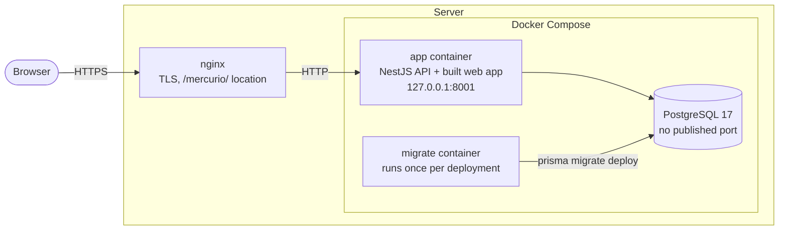
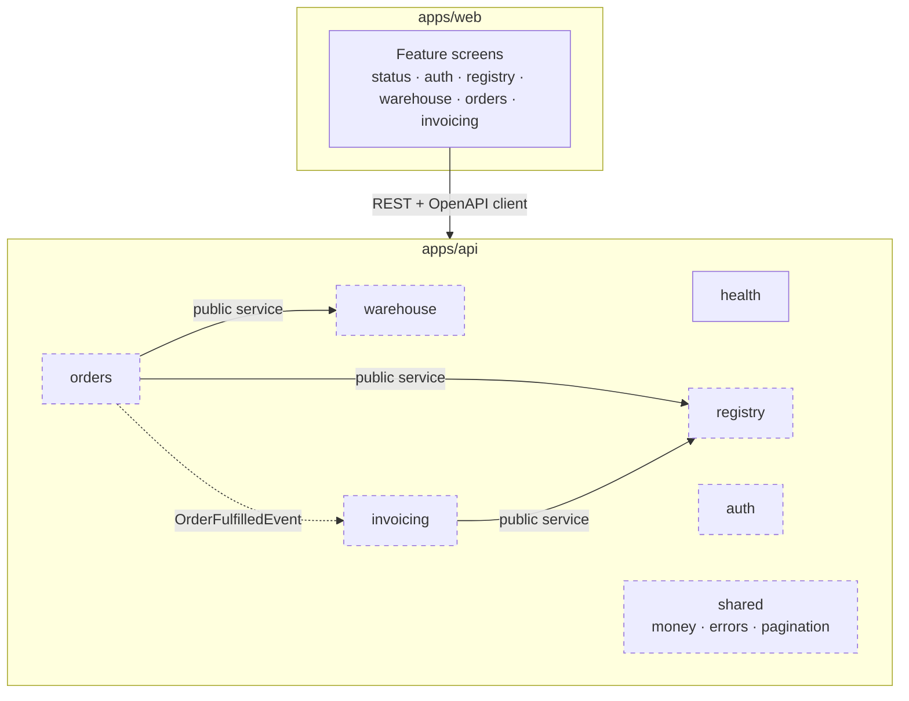

# Architecture

Mercurio is a modular monolith ([ADR 0001](adr/0001-modular-monolith.md)): one NestJS application
with one module per business area, a React single-page app served by the same process
([ADR 0004](adr/0004-api-serves-web-app.md)), and one PostgreSQL database.

This document describes what exists today and marks what is planned. Decisions behind each choice
are in [`adr/`](adr/); coding rules are in [conventions.md](conventions.md).

## Runtime



- **nginx** on the host terminates TLS and forwards `/mercurio/` to the container. It does not
  rewrite paths: the application knows its own prefix from `APP_BASE_PATH`.
- **app** serves the web app under `/mercurio/` and the API under `/mercurio/api/`. It listens only
  on `127.0.0.1`, runs as a non-root user with a read-only filesystem and no Linux capabilities.
- **migrate** applies pending Prisma migrations and exits; the app starts only if it succeeds.
- **db** is reachable only from the Compose network and stores its data in a named volume.

In development the same pieces run without nginx: PostgreSQL in Docker, the API with `nest start
--watch`, and Vite with a proxy for `/api`.

## Delivery


- Every push to `main` publishes images tagged `sha-<commit>` and `latest`; a tag `vX.Y.Z`
  publishes `X.Y.Z` and deploys it. Pull requests only build.
- The server builds nothing and has no copy of the repository: `deploy.sh` pulls the requested
  version, runs the migrations, restarts the app and waits until `/api/health` reports that version.
- GitHub's SSH key can only run `deploy.sh`. See
  [ADR 0007](adr/0007-continuous-delivery-github-actions.md).

## Modules



Dashed boxes are planned (see the roadmap in the [README](../README.md#roadmap)). Today the API has
`health` plus the technical modules `config`, `prisma` and `web`.

Rules that keep the modules independent:

- A module exposes a **public service** or emits **domain events**; everything else is internal.
- A module owns its tables. No module queries another module's tables.
- Inside a module: controller (HTTP) → service (use cases, transactions) → repository (data access).

## Request lifecycle

What every API request goes through, in order:

1. **pino-http** assigns a request id (reusing `X-Request-Id` from nginx when present), returns it
   in the response and logs the request as JSON. Authorization headers and cookies are redacted.
2. **helmet** sets security headers. HSTS is left to nginx, which owns the whole domain.
3. **ThrottlerGuard** applies a global rate limit (300 requests per minute per IP). `/health` is
   exempt.
4. **ValidationPipe** validates the request DTO with class-validator, rejecting unknown fields.
5. The **controller** calls a **service**; the service returns a response DTO, never a database
   model.
6. Errors are returned as RFC 9457 Problem Details with a stable `code`
   ([ADR 0003](adr/0003-problem-details-errors.md)).

## Configuration

Environment variables are validated once at startup with Zod (`apps/api/src/config/app-config.ts`).
With a missing or malformed variable the application refuses to start and lists every problem.

| Variable          | Purpose                                                              |
| ----------------- | -------------------------------------------------------------------- |
| `APP_BASE_PATH`   | Prefix the app lives under: empty locally, `/mercurio` in production |
| `DATABASE_URL`    | PostgreSQL connection URL                                            |
| `APP_VERSION`     | Version reported by `/health` (the commit in production)             |
| `LOG_LEVEL`       | pino log level                                                       |
| `SWAGGER_ENABLED` | API docs at `<base>/api/docs`; on in development, off in production  |
| `WEB_DIST_PATH`   | Folder of the built web app; unset in development                    |

## Health check

`GET <base>/api/health` returns `200` with `status: "ok"` when the database answers within two
seconds, and `503` with `status: "degraded"` otherwise. Docker uses it as the container health check;
the web app's status page polls it every 15 seconds.

## Repository layout

```
apps/
  api/                 NestJS backend
    prisma/            schema and migrations
    src/<module>/      one folder per module (controller, service, DTOs, tests)
    test/              end-to-end tests (real database)
  web/                 React frontend
    src/features/      one folder per feature (screens, queries, tests)
    src/components/    ui/ (shadcn/ui primitives) and shared/ (reusable components)
    src/locales/       translations, one folder per language
deploy/                deployment script and nginx location
docs/                  this documentation and the ADRs
```
