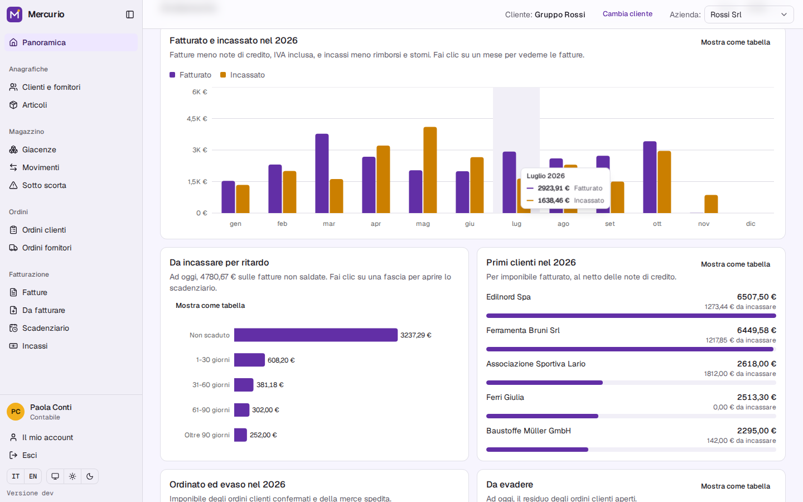
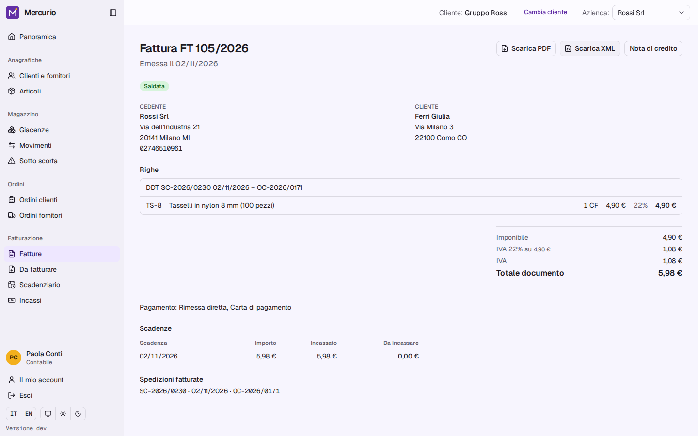
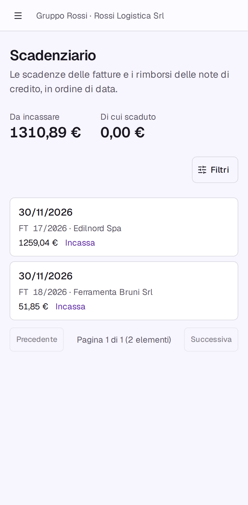

# A tour of Mercurio

One order of the demo, from the customer to the payment: what a person does, and why the system
behaves as it does. Sign in locally as `sara.neri@example.com`, an accountant of the demo
([Run it locally](../README.md#run-it-locally)), and choose the company Rossi Srl.

## 1. The overview

Counters of today, then the year month by month: invoiced and collected, what customers owe by days
overdue, the top customers, sales ordered and shipped, stock movements. Each chart has its table
("Show as a table"), and a click opens the list behind a bar. Each figure needs the permission of
the page it comes from: a warehouse keeper sees the movements, not the invoiced amounts.
→ [ADR 0032](adr/0032-overview-statistics.md)

## 2. A sales order reserves what is there

**Orders → Customers → New order.** Ferramenta Bruni orders screws and a drill. Confirming gives the
order its number (`OC-2026/…`) and **reserves** the goods available in the warehouse: no other issue
can take them. If there are not enough, the order shows what is uncovered; "Reserve available"
takes what arrives later.
→ [ADR 0025](adr/0025-reservations-and-available-stock.md),
[ADR 0024](adr/0024-orders-move-goods-through-the-warehouse.md)

## 3. Shipping writes a stock document

**Ship** records what leaves today, all of it or a part. The shipment and its stock document
(`SC-2026/…`, a delivery note that prints with how the goods travel) are one transaction, with the
rows locked in a fixed order: two people shipping the last pieces at once cannot push the stock
below zero. A shipment is undone by a reversal, never edited.
→ [ADR 0021](adr/0021-warehouse-documents-and-computed-stock.md)

## 4. Invoicing hears the shipment

The shipment appears in **Invoicing → To invoice**: the orders module published an event, inside its
own transaction, and invoicing wrote its copy. Orders do not know invoicing exists; with invoicing
off, nothing listens. A shipment already invoiced can no longer be undone from the order.
→ [ADR 0027](adr/0027-events-inside-the-transaction.md)

## 5. A deferred invoice, issued once

At the end of the month the shipments of a customer become **one invoice**, with the delivery notes
named on its lines. Prices can still change in the draft; quantities cannot, they are what left the
warehouse. **Issue** gives the next number of the year, never before the date of the last one, and
from then on the database itself refuses to change the document.
→ [ADR 0029](adr/0029-fiscal-numbering-and-credit-notes.md),
[ADR 0028](adr/0028-issued-documents-insert-only.md)

## 6. On paper and as FatturaPA

**Download PDF** prints the document in the customer's language; **Download XML** gives the
FatturaPA file (FPR12) that an intermediary would send. Both are made from the saved document at
every request, so they never change. Nothing is transmitted.
→ [ADR 0031](adr/0031-printed-documents.md), [ADR 0033](adr/0033-fatturapa-files.md)

## 7. Payments and the payment schedule

The due dates come from the payment terms (30 days end of month, two instalments…). **Record
payment** proposes to settle the oldest first; a payment can be split over several due dates and
undone by a reversal, when a bank receipt bounces. The schedule shows what is open and what is
late; on a phone it is a list of cards.
→ [ADR 0030](adr/0030-due-dates-and-payments.md)

## 8. A credit note corrects

A wrong price is never fixed on the invoice: **Credit note** on the invoice takes some lines or all
of them, never more than what is left. It reduces the open due dates, and if the customer has
already paid, the rest is a refund.
→ [ADR 0029](adr/0029-fiscal-numbering-and-credit-notes.md)

## And around it

- Every action is in **Activity**, with who did it.
- A second company of the same customer (Rossi Logistica) numbers its documents on its own; the
  other customer, Bianchi, invoices by hand without the warehouse and orders modules.
  → [ADR 0009](adr/0009-companies-and-shared-registry.md),
  [ADR 0011](adr/0011-module-activation-and-boundaries.md)
- The demo is twelve months written through these same rules, up to today.
  → [ADR 0034](adr/0034-demo-history-and-reset.md)
